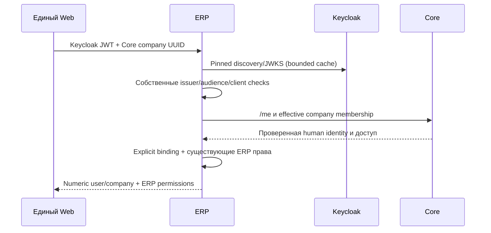

# Совместимый вход ERP через Xarionix Core

Дополнение Sprint 6B к существующему ERP (`08e5f63b82e38b41aa97e17355079d6ef2312977`).
Старые numeric IDs, passwords/Redis sessions, company context, private ownership,
права, адреса и геометрия не преобразуются. Новый путь **opt-in**, без JIT и выдачи
новых токенов. Core остаётся независимым от ERP.

## Доверенные границы

1. ERP независимо проверяет RS256, подписанный `iss`, свою `aud=xarionix-erp`,
   `exp`, `iat`, `nbf`, `typ=Bearer`, `kid` и точный `azp` browser client.
2. Discovery/JWKS доступны только внутри явно настроенного issuer. TLS проверяется,
   redirects/env proxy отключены; документы и ключи ограничены. Ротация поддержана.
3. Тем же токеном ERP вызывает Core `/me` и `/companies/{uuid}/me/permissions`.
   Требуются active human, совпадение issuer/subject и действующее членство.
   Решение не кешируется между запросами. Недоступность Core запрещает операцию.
4. Только явные server-side bindings преобразуют Core UUID в существующие ERP IDs.
   Далее действуют прежние ERP membership/RBAC/private visibility checks.
   Platform Admin Core сам по себе не получает ERP company permissions.

Core и ERP audiences должны быть явно включены в access token public PKCE client.
Core-only token отвергается ERP. Human JWT не передаётся бизнес-модулям.
`X-Core-Company-Id` — UUID выбранной компании; `X-Company-Id` — подтверждённый ERP
ID. Несоответствие запрещено. Legacy HS token с Core context не принимается.
Существующие legacy клиенты без Core header продолжают работать по старому пути.



## Конфигурация

В server-side `.env`, без frontend secrets:

```dotenv
PLATFORM_OIDC_ENABLED=true
PLATFORM_DEVELOPMENT=false
PLATFORM_CORE_API=https://core.example.test/api/v1
PLATFORM_OIDC_ISSUER=https://id.example.test/realms/xarionix
PLATFORM_OIDC_AUDIENCE=xarionix-erp
PLATFORM_OIDC_CLIENT_ID=xarionix-browser
```

Значения URL/клиента заменяются реальными. Core URL — server-to-server API,
не произвольный URL из запроса. HTTP допустим только с явным development=true
и loopback hostname. Никакого `verify=False` или fallback к password login.
В deployment обеспечьте DNS/HTTPS для issuer из ERP, а не только из браузера.
В Keycloak добавьте client audience mapper `xarionix-erp` именно для этого PKCE
client; секрет клиента в Web не нужен. Managed master-admin не используется.

## Additive schema и связывание

`platform_user_bindings`, `platform_company_bindings`, `platform_binding_audit`
создаются существующим ERP startup `Base.metadata.create_all()`. Это **новые**
таблицы: старые columns/CHECK/FK не переписываются, данные не переносятся.
FK к существующим users/companies — RESTRICT. Core migrations не изменяются.
Обычный runtime не имеет HTTP endpoint для создания binding.

Перед связыванием оператор проверяет в Core фактические User UUID, Company UUID
и `(issuer, subject)`, затем отдельно существующие ERP записи и их права.
Совпадение email/display name не является доказательством. После backup ERP DB:

```bash
PYTHONPATH=app .venv/bin/python -m tools.platform_bindings user \
  --core-id <verified-core-user-uuid> --erp-id <existing-erp-user-id> \
  --subject <verified-keycloak-subject>
PYTHONPATH=app .venv/bin/python -m tools.platform_bindings company \
  --core-id <verified-core-company-uuid> --erp-id <existing-erp-company-id>
```

Связывание ERP system administrator требует отдельного `--allow-system-admin`.
Создание не меняет роли и не создаёт users/companies. Uniqueness предотвращает
неоднозначную/повторную mapping. Подмена существующей binding не поддержана CLI.
Операция и operator OS account записываются атомарно в audit, без JWT/паролей.

Для отзыва используйте тот же `kind --core-id ... --revoke`; DELETE бизнес-данных
не выполняется. Отзыв действует на новые запросы; распределённая транзакция между
Core и ERP не заявляется. Текущую операцию, уже авторизованную обоими серверами,
нельзя гарантированно отменить сетевым отзывом задним числом.

## API и Web

`GET /api/v1/auth/platform-context` требует verified OIDC и Core company header.
Ответ содержит `core_user_id`, `core_company_id`, прежние `user`/`company` DTO,
`permissions` и `scopes`. Unlinked identity/company: 403, без автоматического POST.
Закрытый Core: 403; недоступный provider: отказ 401/503, без обхода проверки.
Cookies и JWT не публикуются в errors/logs. Pydantic startup errors скрывают inputs.

Основной Web включает `erpEnabled: true` только после настройки этого backend и
bindings. Он использует отдельный числовой adapter; Core UUID DTO не меняются.
В production публикуются только разрешённые map/address/context endpoints через
HTTPS reverse proxy. Старые login/refresh/setup/debug не публикуются новой оболочкой.
Logout выполняется Keycloak; legacy session management с OIDC получает 409.

## Проверка

`pytest` включает `tests/authorization/test_platform_identity.py` и все прежние
тесты карты. Нужны отдельные тестовые PostgreSQL/Redis (`TEST_*` из conftest),
никогда рабочая DB: fixtures пересоздают схему.

Настоящий PKCE + OTP + Core + ERP browser integration выполняется из Web:

```bash
../xarionix-core/.venv/bin/python scripts/console_integration.py \
  --core ../xarionix-core --erp ../xarionix-erp
```

Он создаёт собственные PostgreSQL/Redis/realm, использует настоящий operator CLI,
проверяет отказ до связывания и доступ после него. Требуется ERP `.venv` с
`requirements-dev.txt`. Установленные dev/prod DB и volumes не используются.
Новый путь не означает автоматическую миграцию всех исторических ERP workflow:
в общий Web подключены карта/адреса; остальные старые страницы сохранены в
migration target, Core company/employee/role pages имеют собственные контракты.

## Проверка зависимостей

При аудите исходного ERP обнаружен уязвимый `PyJWT 2.13.0`. Закреплён `2.15.1`,
совпадающий с проверенным Core lock; исправления описаны в
[официальном changelog](https://pyjwt.readthedocs.io/en/2.15.1/changelog.html).
На ARM/macOS дополнительно требуется `SQLAlchemy[asyncio]`: без extra не ставился
`greenlet` и async DB операции завершались ошибкой. Версия SQLAlchemy сохранена.

В ERP CI сохранён прежний `pytest` и добавлены обязательные `platform-security`
(Bandit для нового auth слоя и pip-audit project dependencies) и `platform-secrets`
(Gitleaks полной Git history). Единственное точное исключение secret scan — публичный
синтетический signing fixture `test-map-secret!` в двух offline test/CI файлах.
Исключений по целому файлу/правилу нет. Новых production secrets в CI не требуется.
